# 🍅 토마토 메모장

**바탕화면에서 토마토를 키우며 쓰는 메모 위젯** (Windows)

작은 화분의 줄기에 물을 주면 꽃이 피고 토마토가 열려요. **토마토 하나가 메모 하나**예요.
메모는 날이 갈수록 초록에서 빨강으로 익어서, 오래 묵은 일이 한눈에 보여요.
다 끝낸 메모는 **수확**해서 이달의 **잼 병**에 담고, 잼 병은 1년짜리 **잼 선반**에 차곡차곡 쌓여요.

  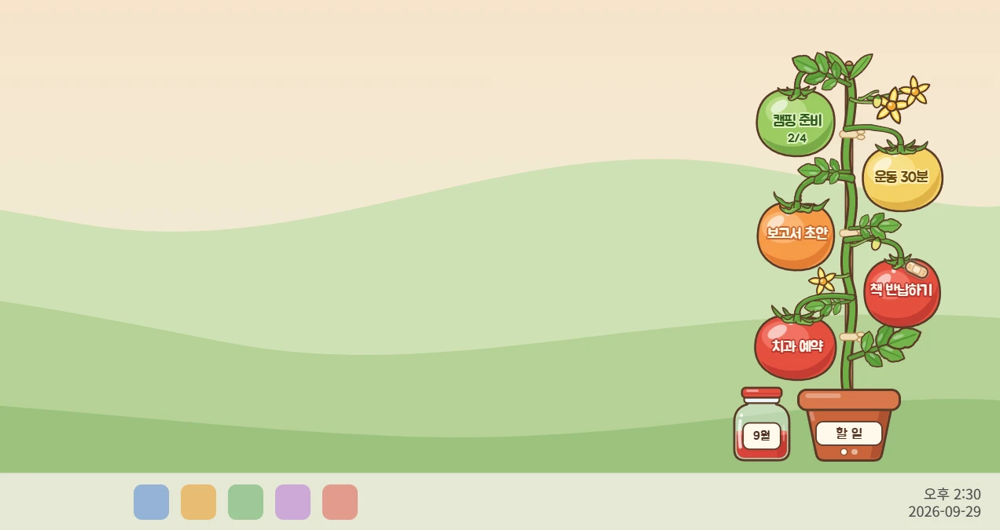

## 📸 둘러보기

### 줄기에 물 주면 새 토마토
**줄기에 마우스를 올리면 물뿌리개가 나타나요.** 누르면 물을 주고, 꽃이 피었다가 새 토마토가 열리면서 메모지가 펼쳐져요.

  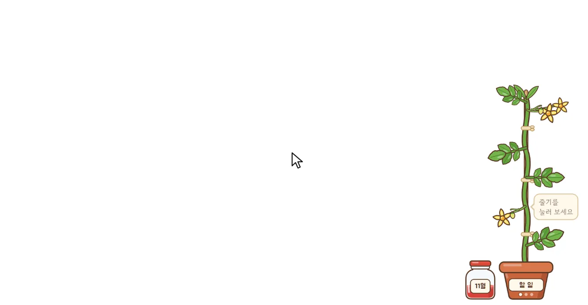

### 토마토 모양 메모지
**토마토를 누르면 메모지가 펼쳐져요.** 오른쪽 맨 윗줄이 제목, 그 아래가 본문이에요.
왼쪽 면엔 만든 날짜, 익은 정도, 할 일 진행도가 보여요.

  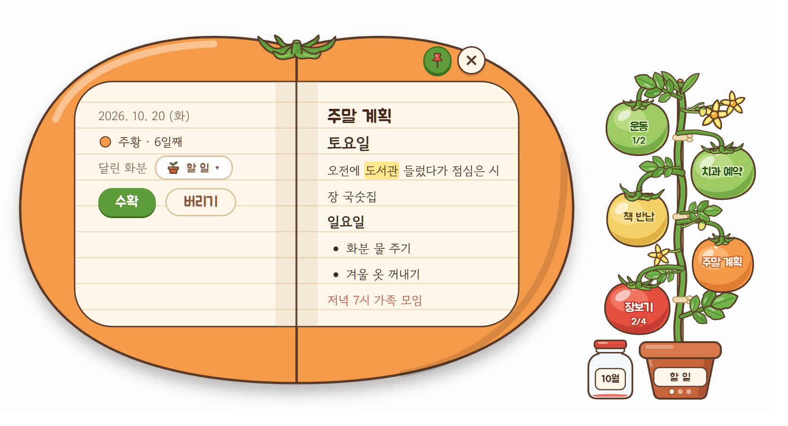

- **X 옆 압정을 누르면 고정**돼요 (초록 동그라미). 바깥을 누르거나 다른 프로그램을 써도 닫히지 않아서, 바탕화면에 붙여 둔 포스트잇처럼 열어 둔 채로 일할 수 있어요. X 로 닫아요.
- 글자를 드래그하면 **꾸미기 도구줄**이 떠요. 글자 크기(작게·중간·크게)도 여기서 바꿔요.
- 쓰는 대로 **저절로 저장**돼요. 고친 뒤엔 왼쪽 면에 `저장됨 · 오늘 오후 3:12`처럼 보여요.
- 인터넷 주소를 쓰면 **링크**가 되고, 누르면 브라우저로 열려요.
- 줄바꿈은 윈도우 메모장처럼 **낱말 단위**예요.
- **설정 → 보기**에서 메모지 크기(보통·크게)와 **공책 줄**(보통·흐리게·없음)을 바꿀 수 있어요.

체크리스트를 채우면 토마토에 진행도가 보이고, 다 하면 초록으로 바뀌어요.

  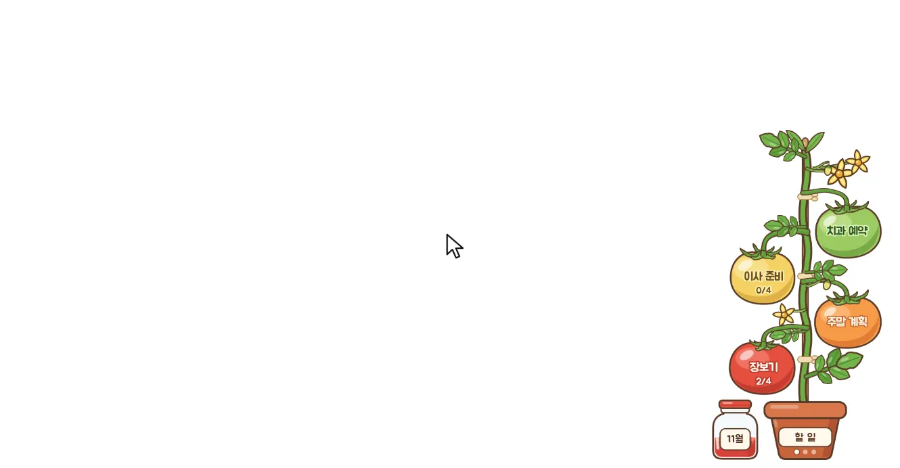

### 열지 않고 살짝 보기
토마토에 마우스를 올리면 **미리보기 이름표**가 떠요. 서식과 줄바꿈이 메모지와 똑같아서, 열지 않고도 한눈에 보여요 (8줄까지).

  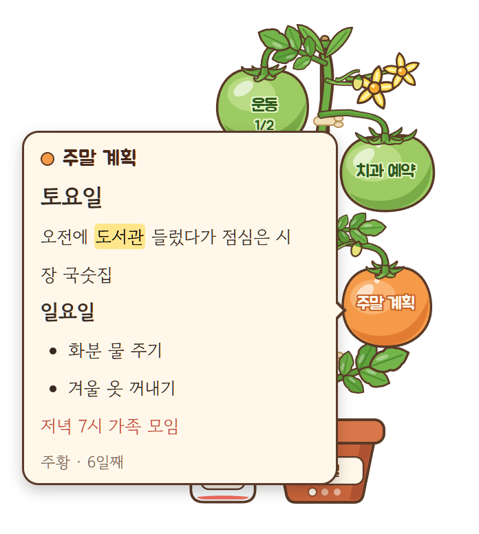

### 날이 갈수록 익어요 · 화분 여러 개

<table>
  <tr>
    <td align="center" width="50%">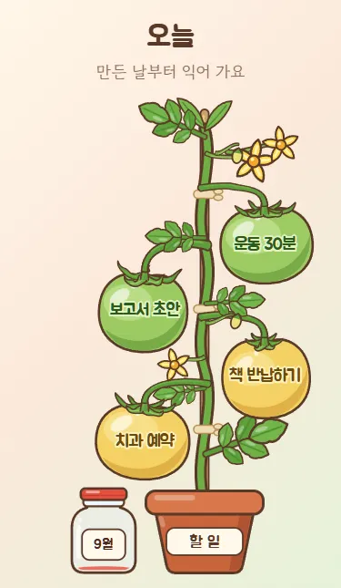</td>
    <td align="center" width="50%">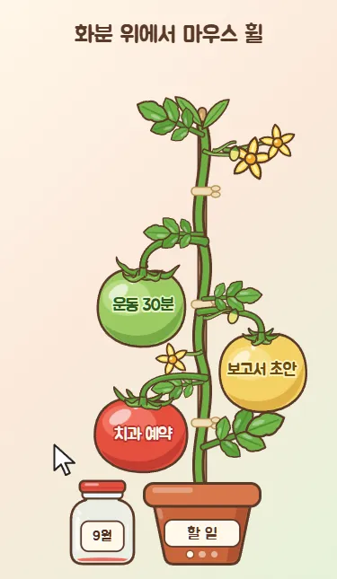</td>
  </tr>
  <tr>
    <td align="center"><b>익어 가기</b> 만든 날부터 초록 → 노르스름 → 주황 → 빨강</td>
    <td align="center"><b>화분 넘기기</b> 화분 위에서 마우스 휠을 굴려요</td>
  </tr>
  <tr>
    <td align="center">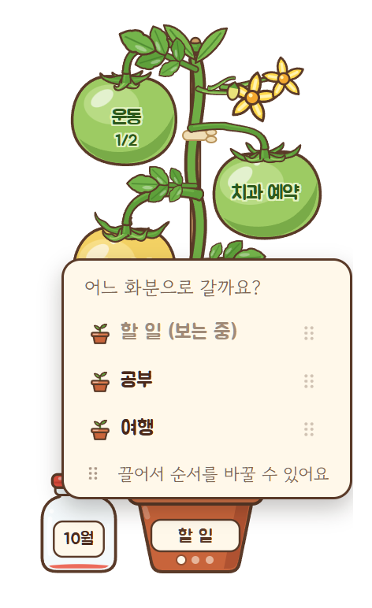</td>
    <td align="center">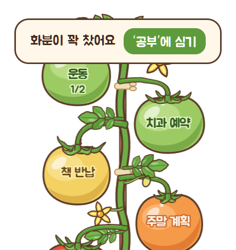</td>
  </tr>
  <tr>
    <td align="center"><b>화분 순서 바꾸기</b> 화분 목록에서 줄을 끌어 옮겨요</td>
    <td align="center"><b>꽉 차면 다른 화분에</b> 자리가 있는 화분(없으면 새 화분)에 바로 심어요</td>
  </tr>
</table>

### 다 한 메모는 수확해서 잼 병에
메모지의 **수확** 버튼을 누르거나, **토마토를 끌어서 잼 병에 놓아도** 돼요. 가까이 가면 뚜껑이 달그락 열려요.

  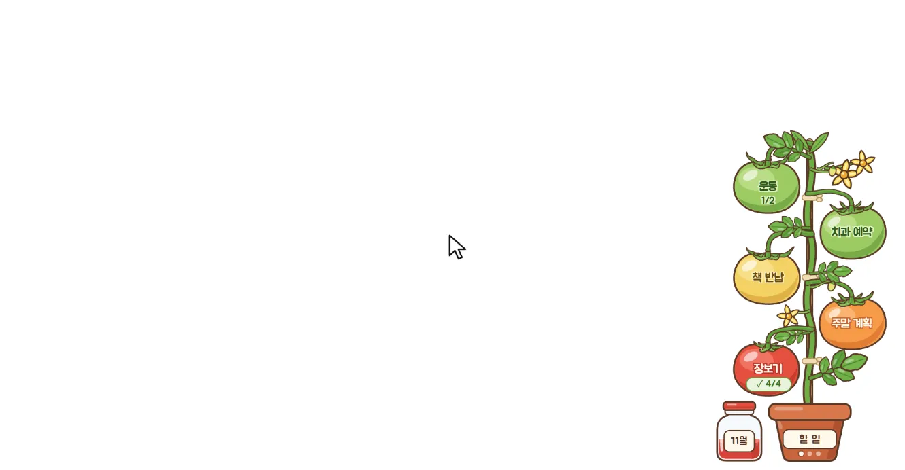

잼 병 메모를 줄기로 **다시 심을** 수도 있어요. 다시 심은 토마토엔 반창고가 붙어요.

  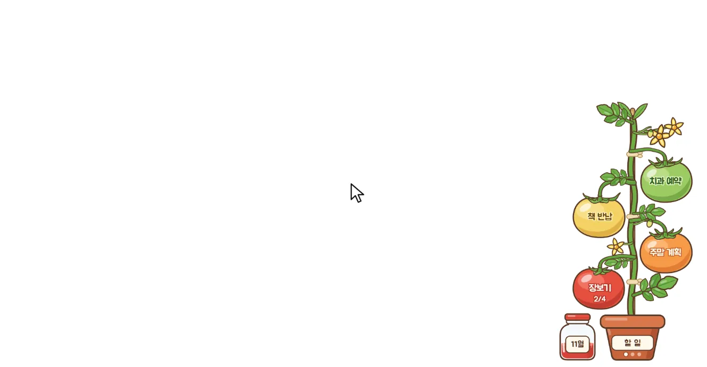

<table>
  <tr>
    <td align="center" width="50%">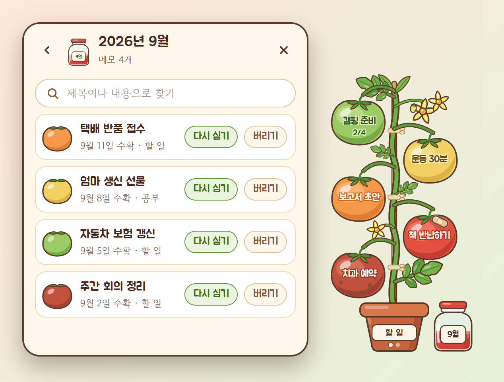</td>
    <td align="center" width="50%">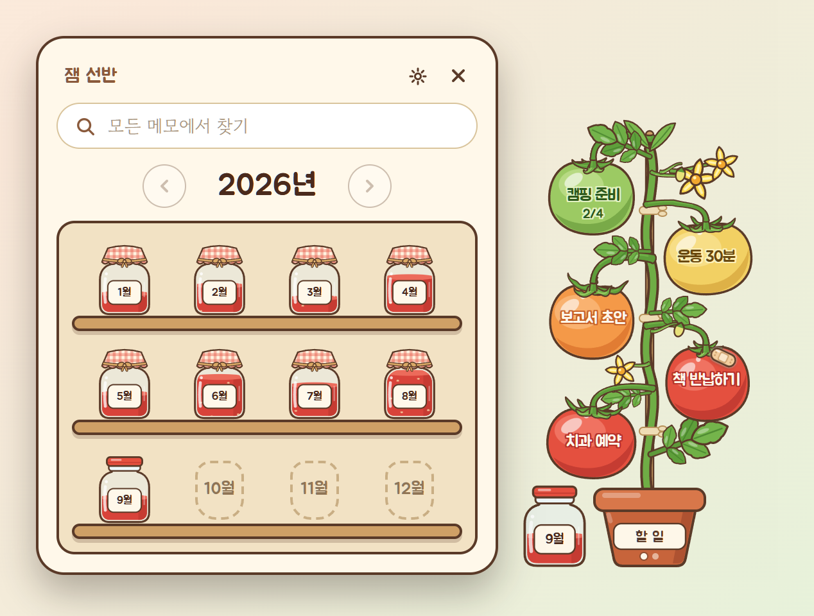</td>
  </tr>
  <tr>
    <td align="center"><b>이번 달 잼 병</b> 수확한 메모가 모여요.</td>
    <td align="center"><b>잼 선반</b> 1년치 잼 병이 달마다 쌓여요.</td>
  </tr>
  <tr>
    <td align="center" width="50%">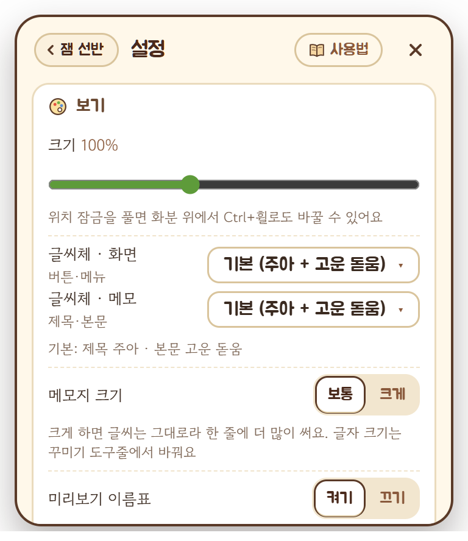</td>
    <td align="center" width="50%">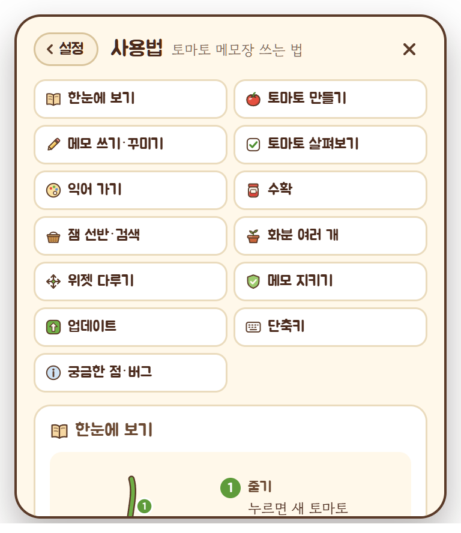</td>
  </tr>
  <tr>
    <td align="center"><b>설정</b> 묶음별 카드로 정리돼 있어요.</td>
    <td align="center"><b>사용법</b> 그림과 함께 보는 사용 설명서가 앱 안에 있어요.</td>
  </tr>
</table>

사진 속 메모와 바탕화면은 모두 예시예요.

---

## ⬇️ 설치하기

1. 오른쪽 **Releases**에서 가장 위(Latest) 버전을 열어요.
2. **`TomatoMemo_버전_x64-setup.exe`** 하나만 받아서 실행해요.
   (다른 파일 `latest.json`, `.sig` 는 자동 업데이트용이라 받지 않아도 돼요.)
3. 설치가 끝나면 바탕화면 오른쪽 아래에 화분이 나타나요.

> **"Windows의 PC 보호" 파란 창이 뜨면?**
> 아직 널리 알려지지 않은 개인 프로그램이라 윈도우가 한 번 확인하는 창이에요.
> **추가 정보 → 실행**을 누르면 설치돼요.

- 관리자 권한 없이 **내 계정에만** 설치돼요.
- 처음 켜면 **윈도우를 켤 때 자동 실행**이 켜져 있어요. **설정 → 위젯 자리**에서 끌 수 있어요.
- 시작 화면에 고정하려면: 시작 메뉴 → 모든 앱 → **TomatoMemo** 오른쪽 클릭 → **시작 화면에 고정**
- 필요한 것: Windows 10 / 11 (64비트)
- 지우려면: 윈도우 **설정 → 앱 → 설치된 앱 → TomatoMemo → 제거**. 자동 실행 등록도 같이 지워져요. 메모 폴더(`%USERPROFILE%\.tomatomemo`)는 남아 있어서, 다시 설치하면 그대로 이어져요.

## 🔄 자동 업데이트

새 버전이 나오면 앱이 알아서 알려 줘요. 켤 때 한 번, 그리고 하루 한 번 확인해요 (인터넷이 늦게 연결되면 연결될 때 다시 확인해요).

- 화분 위에 **새 버전 안내**가 떠요. **업데이트**를 누르거나 **×**로 닫을 때까지 떠 있고, 닫은 버전은 다시 뜨지 않아요.
- 화분 이름표에 **초록 점**이 남고, 화분 메뉴 맨 위에 "**새 버전으로 업데이트**"가 있어서 나중에 할 수도 있어요.
- 누르면 받아서 설치하고 다시 켜져요. **누르기 전에는 아무것도 바뀌지 않아요.**
- 업데이트하면 **바뀐 점 카드**가 한 번 떠요. 지난 내용은 **설정 → 정보 → 업데이트 내역**에서 볼 수 있어요.

  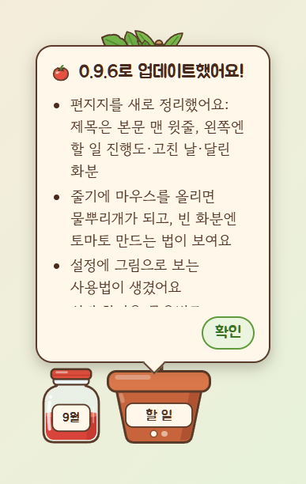

- 모든 업데이트 파일에는 **디지털 서명**이 붙어 있어요. 앱은 서명이 맞는 파일만 설치해요.

---

## 🌱 이렇게 써요

> 더 자세한 설명은 앱 안 **설정 → 사용법**에 그림과 함께 있어요.

| 하고 싶은 것 | 방법 |
|---|---|
| 새 메모 (토마토 달기) | **줄기 클릭** (물뿌리개로 물 주기). **설정 → 단축키**에서 `Ctrl+Alt+N` 을 켜면 다른 프로그램을 쓰다가도 바로 만들어요 (처음엔 꺼져 있어요). 화분 하나에 **5개까지**. 꽉 차면 안내의 버튼으로 자리가 있는 다른 화분(없으면 새 화분)에 심어요 |
| 메모 쓰기·보기 | 토마토 클릭 → 토마토 모양 **메모지** (맨 윗줄 제목, `Enter` 로 본문). 긴 메모도 늘 맨 위부터 보여요 |
| 열지 않고 살짝 보기 | 토마토에 마우스를 잠깐 올리기 (미리보기 이름표, 서식 그대로) |
| 닫기 (자동 저장) | X 버튼, `Esc`, 또는 메모지 바깥 클릭. 아무것도 안 쓴 새 토마토는 닫으면 저절로 사라져요 |
| 열어 둔 채로 쓰기 | 메모지 X 옆 **압정** → X 로만 닫혀요. 고정한 채 다른 토마토를 누르면 그 메모로 바뀌어요 |
| 다 한 메모 | 메모지의 **수확**, 또는 **토마토를 끌어서 잼 병에 놓기** → 이달의 잼 병으로 (잠깐 뜨는 **되돌리기**로 취소) |
| 버리기 | 메모지의 **버리기**. 줄기 토마토는 바로 버리고 **되돌리기**가 떠요. 잼 병 메모는 "버릴까요?"를 한 번 더 물어요 |
| 이번 달 잼 병 보기 | 화분 옆 **잼 병 클릭** (왼쪽 위 **‹ 잼 선반** 을 누르면 1년치 선반) |
| 메모 찾기 | 잼 선반 맨 위 검색 칸 (줄기·잼 병의 모든 메모) |
| 잼 병 메모를 다시 줄기로 | **다시 심기** → 반창고를 붙이고 돌아와요 (화분이 여럿이면 어느 화분에 심을지 골라요) |
| 화분 메뉴 | **화분 클릭** 또는 위젯 오른쪽 클릭: 새 토마토 · 잼 선반 보기 · 다른 화분으로 · 새 화분 · 이름 바꾸기 · 이 화분 치우기 · 위치 잠금 · 사용법 · 설정 |
| 화분 넘기기 | 위젯 위에서 **마우스 휠** |
| 화분 순서 바꾸기 | 화분 메뉴 → **다른 화분으로** 목록에서 줄을 끌기 |
| 위젯 옮기기 | 화분을 누른 채 끌기 (모니터마다 자리를 기억해요). 헤매면 **설정 → 위젯 자리 → 처음 자리로** |
| 바탕화면 보기 | `Win+D` 를 해도 위젯은 바탕화면에 남아 있어요 |
| 크기 바꾸기 | **설정 → 보기**. 메모지만: **설정 → 보기 → 메모지 크기** (처음엔 크게) |
| 숨기기 / 끄기 | 작업 표시줄 오른쪽 아래 **토마토 아이콘**: 클릭 = 숨기기/보이기, 오른쪽 클릭 = 설정 · 사용법 · 위젯 제자리로 · 문제 보내기 · 종료 |
| 위젯이 안 보일 때 | 토마토 아이콘 오른쪽 클릭 → **위젯 제자리로** |
| 링크 열기 | 메모 속 파란 밑줄 주소를 누르면 기본 브라우저로 열려요 |

### 🍅 익어 가는 토마토
메모를 만든 날부터 색이 변해요. 며칠 만에 익을지는 **설정 → 토마토**에서 바꿀 수 있어요.
줄기 **아래쪽이 오래된 메모**, 위쪽이 새 메모예요.

`초록` → 2일 `노르스름` → 5일 `주황` → 8일 `빨강`

- 색은 **만든 날 기준**이에요. 고치거나 다시 심거나 다른 화분으로 옮겨도 그대로예요. 잼 병 메모는 수확한 날의 색에서 멈춰요.
- 원하면 아주 오래된 토마토에 **갈색 반점**이 생기게 할 수도 있어요 (설정, 처음엔 꺼져 있어요).
- 토마토마다 꼭지·열매자루 모양이 조금씩 달라요. 토마토가 많이 달리면 잎도 무성해져요.

### ✍️ 메모지 꾸미기
본문 글자를 드래그하면 도구줄이 떠요. **굵게** · *기울임* · 밑줄 · 취소선 · 형광펜 · 글자 색 · 글자 크기(작게·중간·크게) · 글머리 기호 · ☑ 체크리스트 · 서식 지우기.
큰 글자를 섞어도 공책 줄에 맞춰 써져요. 주소를 쓰고 띄어 쓰거나 붙여 넣으면 저절로 링크가 돼요.
체크리스트를 쓰면 토마토에 `2/5` 처럼 진행도가 보이고, 다 채우면 반짝여요.

| 단축키 | |
|---|---|
| `Ctrl+B` / `Ctrl+I` / `Ctrl+U` | 굵게 / 기울임 / 밑줄 |
| `Ctrl+Shift+S` | 취소선 |
| `Ctrl+Shift+H` | 형광펜 |
| `Ctrl+Shift+8` / `Ctrl+Shift+9` | 글머리 기호 / 체크리스트 |
| `Ctrl+Z` / `Ctrl+Y` | 되돌리기 / 다시 하기 |

### 🍯 잼 병
잼 병은 처음엔 **자동**이에요. 위젯을 화면 오른쪽에 두면 화분 왼쪽에, 왼쪽에 두면 오른쪽에 놓여요 (화면 안쪽).
**설정 → 잼 병**에서 왼쪽·오른쪽으로 고정할 수도 있어요.

같은 곳에서 병이 **가득 차는 개수**와, 오래된 잼 병 메모를 **저절로 지울 기간**(처음엔 영원히 보관)도 정해요.

### 🌿 화분 여러 개
- 화분 메뉴의 **새 화분**으로 늘려요. 위젯 위에서 **마우스 휠**을 굴리거나 **다른 화분으로**에서 골라 넘어가요.
- 순서는 **다른 화분으로** 목록에서 줄을 끌어 바꿔요 (줄 오른쪽 점 여섯 개 손잡이). 휠로 넘기는 순서도 같이 바뀌어요.
- 화분이 꽉 찼을 때 줄기를 누르면, 자리가 있는 다음 화분에 심을지(없으면 새 화분) 버튼으로 물어봐요.
- 토마토를 다른 화분으로 옮기려면 메모지 왼쪽의 **달린 화분** 버튼을 눌러요.
- **이 화분 치우기**를 하면 달린 토마토도 함께 지워져요. 잼 병 메모는 그대로 남아요.

### 📱 휴대폰에서 보기
<table>
  <tr>
    <td align="center" width="50%">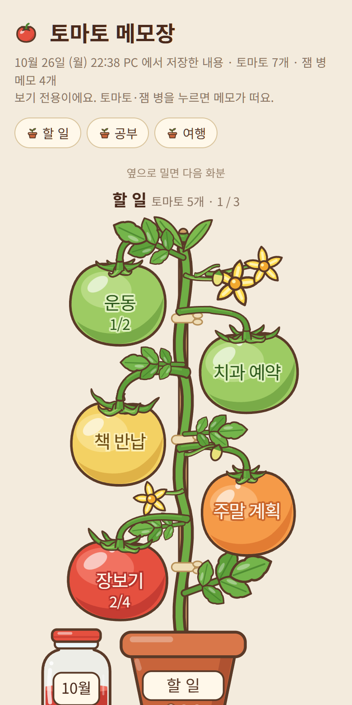</td>
    <td align="center" width="50%">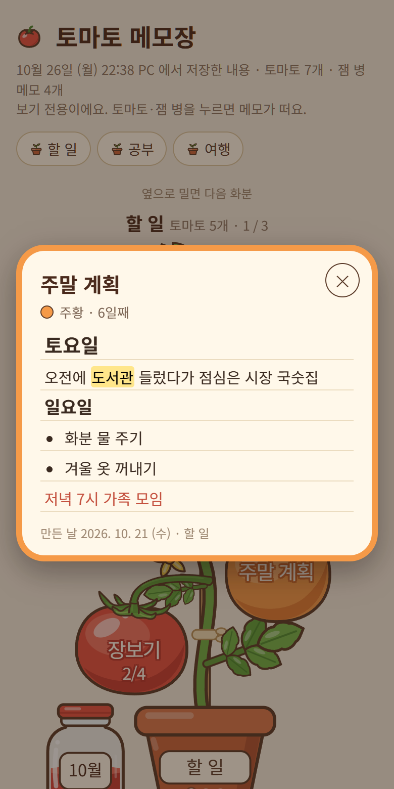</td>
  </tr>
</table>

- **설정 → 메모 지키기 → 휴대폰에서 보기**를 켜고 iCloud·원드라이브·구글 드라이브 폴더를 고르면, 메모를 고칠 때마다 그 폴더의 `토마토 메모장.html`을 새로 써요. 기본은 꺼져 있어요.
- 휴대폰의 파일 앱이나 드라이브 앱에서 그 파일을 열면 위젯과 똑같은 화분이 보여요. 토마토·잼 병을 누르면 메모가 뜨고, 옆으로 밀면 다음 화분이에요.
- 보기만 돼요. 고치기는 PC에서 해요.
- 아이폰은 단축어의 "파일 열기"로 이 파일을 홈 화면에서 바로 열 수 있어요.

### 🗑️ 실수로 지웠다면
- 버린 직후엔 안내 문구의 **되돌리기**를 누르면 돼요.
- 며칠 지났어도 **설정 → 메모 지키기 → 지운 메모 찾기**에서 최근 한 달 백업을 뒤져 **되살리기**할 수 있어요. 되살리기 전에 내용도 볼 수 있어요.

---

## 💾 메모는 어디에?

메모는 **내 컴퓨터에만** 저장돼요. 인터넷으로 보내지 않아요. (**휴대폰에서 보기**를 켜면 메모 내용이 고른 클라우드 폴더에도 저장돼요.)

- 위치: `%USERPROFILE%\.tomatomemo\` (예: `C:\Users\내이름\.tomatomemo`)
- 쓸 때마다 자동 저장하고, **하루 한 번 백업**을 한 달치(30개) 남겨요.
- 메모 파일이 깨지면 직전 저장본이나 백업에서 **저절로 되살려요**. 저장이 잠깐 안 되면 알려 주고 저절로 다시 저장해요.
- 다른 컴퓨터로 옮기거나 따로 보관하고 싶으면 이 폴더를 통째로 복사하면 돼요.

## 💌 피드백·버그 제보

앱 안 **설정 → 정보 → 피드백·버그 제보**, 또는 트레이 아이콘 오른쪽 클릭 → **문제 보내기**에서 만든 사람에게 바로 보낼 수 있어요.

- 보내지는 것: 적은 글, 종류(버그·제안·기타), 적었다면 연락처, 앱 버전·윈도우 버전
- **기록 파일**(최근 한 달 동안 켜고 끈 기록과 오류)도 같이 보내요. 원인을 찾기 쉬워요. 보내기 싫으면 **기록 파일도 같이 보내기**를 끄면 돼요.
- 앱이 갑자기 꺼졌거나 문제가 있었으면(위젯 제자리로, 저장 실패) 다음에 켤 때 그때의 기록을 **보낼지 물어봐요**. 누르기 전에는 아무것도 보내지 않아요.
- **메모 내용은 보내지 않아요.**

## 🔒 개인정보

- 가입이 없고, 메모는 **내 컴퓨터에만** 있어요. 광고, 사용 통계, 쿠키는 없어요.
- 인터넷으로 보내는 건 **직접 [보내기]를 누를 때만**이에요: 피드백, 꺼짐 보고, 문제 보고.
  메일 전달 서비스(Web3Forms)를 거쳐 만든 사람의 메일로 가요. 받은 메일은 문제가 해결되면 지우고, 늦어도 1년 안에 지워요.
- **휴대폰에서 보기**를 켜면 메모가 직접 고른 클라우드 폴더에 파일로 저장돼요. 만든 사람은 받지 않아요.
- **새 버전 확인**은 GitHub에 새 버전이 있는지만 물어봐요.
- 자세한 내용은 앱 안 **설정 → 정보 → 개인정보 처리방침**에 있어요.

## 🍃 가볍게

가만히 있을 때는 CPU를 거의 쓰지 않도록 만들었어요. 움직임은 누를 때만 잠깐 나타나요.
설정에서 움직임(애니메이션)을 끌 수도 있어요.

## 🍫 후원

토마토 메모장은 무료예요. 만든 사람은 초코우유를 정말 좋아해요. 마음에 들었다면 초코우유 하나(2,000원) 사 주세요.
휴대폰 카메라로 아래 QR을 찍으면 카카오페이 송금 화면이 열려요. 앱 안 **설정** 맨 위에서도 같은 QR을 볼 수 있어요.

  

---

## 글꼴

- [주아 (Jua)](https://fonts.google.com/specimen/Jua) · [고운 돋움 (Gowun Dodum)](https://fonts.google.com/specimen/Gowun+Dodum) — SIL Open Font License 1.1
- 설정에서 화면 글씨체와 메모 글씨체를 내 컴퓨터의 한글 글꼴로 바꿀 수 있어요.

Tauri · Rust 로 만들었어요. 이 저장소는 설치 파일과 자동 업데이트 파일을 나눠 주는 곳이에요. 앱에 들어간 오픈소스 부품과 라이선스는 앱 안 설정 → 정보 → 오픈소스 라이선스에 있어요. iCloud는 Apple, 원드라이브·Windows는 Microsoft, 구글 드라이브는 Google, 카카오페이는 카카오페이의 상표이고, 토마토 메모장은 이 회사들과 관계없어요.
